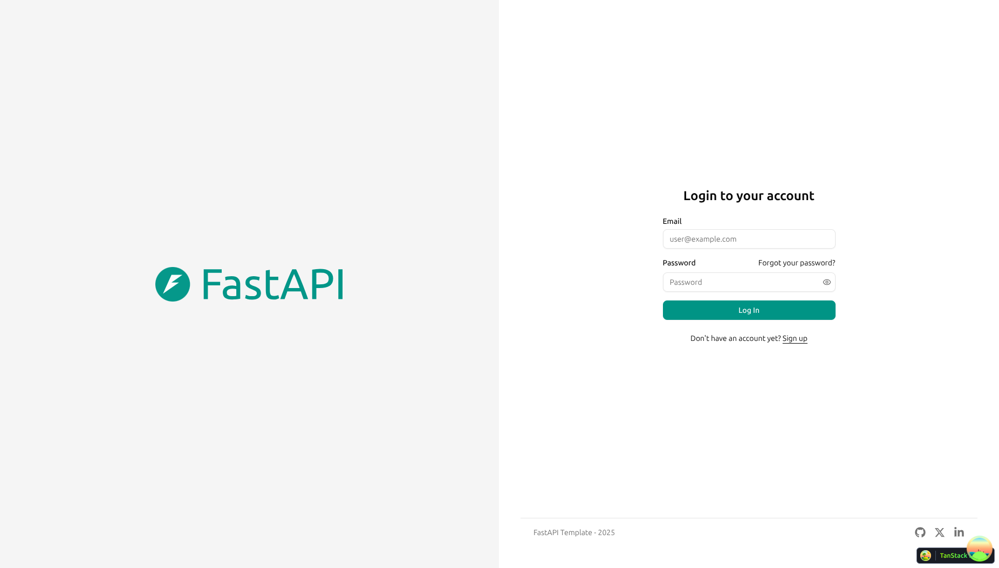
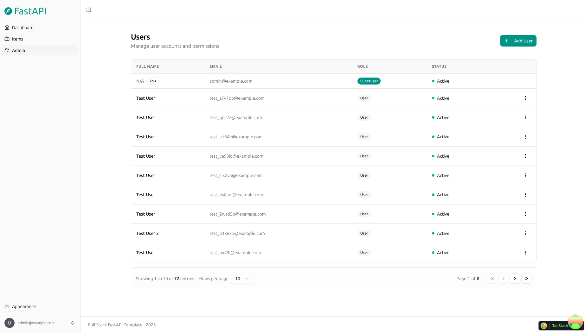
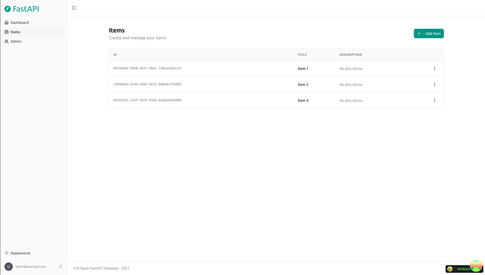
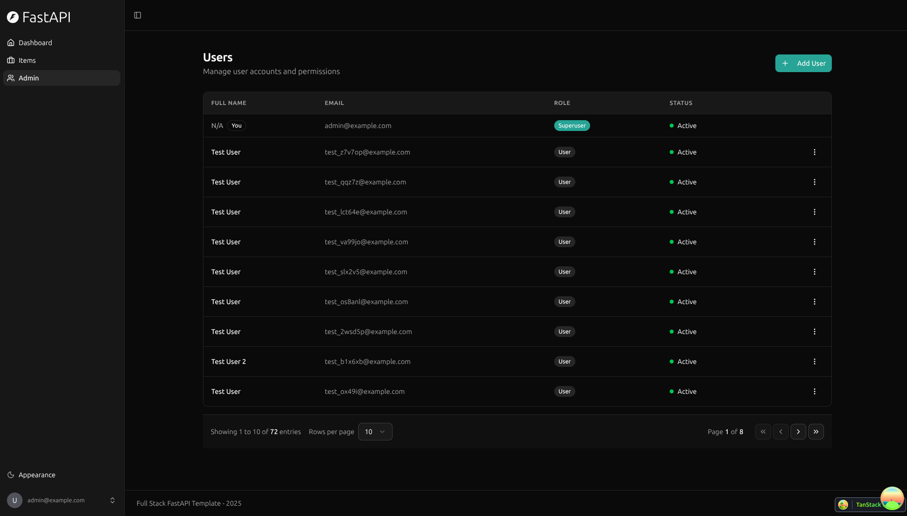
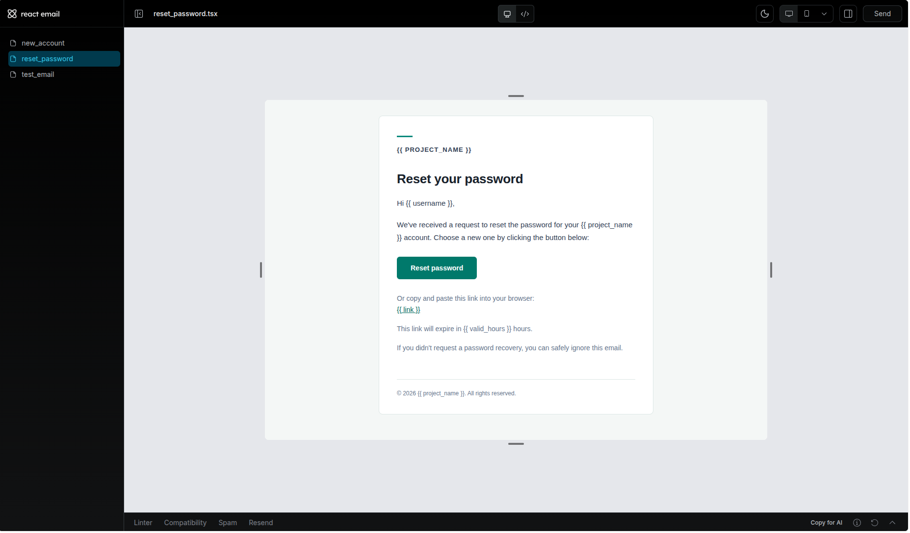
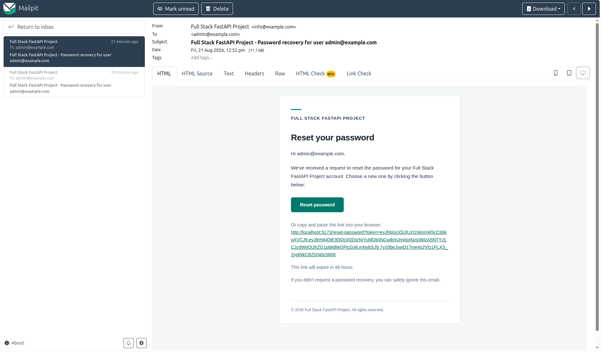
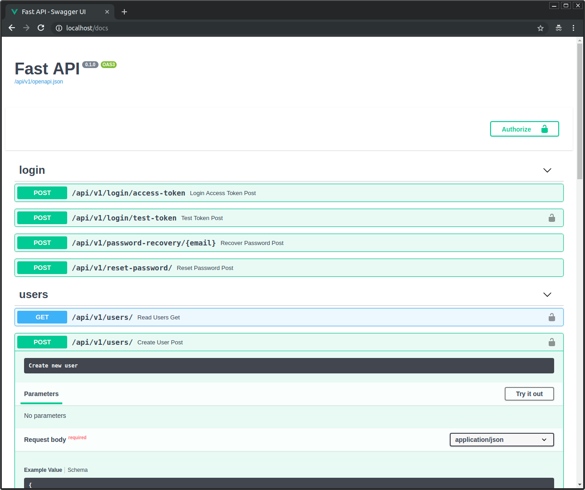

# Full Stack FastAPI Template

A reusable full-stack template for building web applications and technical take-home challenges.

[](../../actions/workflows/test-docker-compose.yml)
[](../../actions/workflows/test-backend.yml)

## Technology Stack and Features

- ⚡ [FastAPI](https://fastapi.tiangolo.com) for the Python backend API.
  - SQLModel for database interactions.
  - Pydantic for data validation and settings management.
  - PostgreSQL as the relational database.
- 🚀 React for the frontend.
  - TypeScript, Vite, TanStack Router and TanStack Query.
  - Tailwind CSS and shadcn/ui.
  - Automatically generated API client.
  - Playwright for end-to-end testing.
- 🐋 Docker Compose for local development and deployment.
- 🔒 Password hashing and JWT authentication.
- 📫 Email-based password recovery.
- ✉️ React Email templates.
- 📬 Mailpit for local email testing.
- ✅ Pytest for backend testing.
- 🧹 Pre-commit hooks with prek.
- 🔄 GitHub Actions for continuous integration.

## Dashboard Preview

### Dashboard Login



### Dashboard - Admin



### Dashboard - Items



### Dashboard - Dark Mode



### React Email Templates



### Mailpit - Local Email Testing



### Interactive API Documentation



---

# Getting Started

Follow these steps to create a new project from this template.

## 1. Create a New Repository

1. Click **Use this template** at the top of this repository.
2. Select **Create a new repository**.
3. Choose the repository name and visibility.
4. Clone your newly created repository:

```bash
git clone https://github.com/YOUR_USERNAME/YOUR_PROJECT.git
cd YOUR_PROJECT
```

The new repository is independent of this template. You can modify its code without affecting the original repository.

## 2. Configure Environment Variables

Create your local environment file:

```bash
cp .env.example .env
```

Open `.env` and configure the project-specific values.

At minimum, configure:

| Variable | Description |
|---|---|
| `PROJECT_NAME` | Application name |
| `SECRET_KEY` | Secret used to sign authentication tokens |
| `FIRST_SUPERUSER` | Initial administrator email |
| `FIRST_SUPERUSER_PASSWORD` | Initial administrator password |
| `POSTGRES_PASSWORD` | PostgreSQL password |
| `ROOT_PATH` | External URL prefix; empty for local development |

Generate secure values instead of using example passwords.

Generate a secret key:

```bash
python -c "import secrets; print(secrets.token_urlsafe(32))"
```

Generate a PostgreSQL password:

```bash
python -c "import secrets; print(secrets.token_urlsafe(32))"
```

Generate the initial administrator password:

```bash
python -c "import secrets; print(secrets.token_urlsafe(32))"
```

Copy each generated value into the corresponding variable in `.env`.

**Important:**

- Never commit `.env` to Git.
- Never use example credentials in a public deployment.
- Keep `.env.example` updated whenever new environment variables are introduced.
- SMTP configuration is optional for initial development. Mailpit is available for local email testing.

## 3. Choose Your Development Workflow

There are two ways to run the application locally.

### Option A: Local Development (Recommended)

This workflow runs PostgreSQL and Mailpit in Docker, while FastAPI and Vite run directly on your machine.

**Requirements:**

- Python 3.14+
- [uv](https://docs.astral.sh/uv/)
- [Bun](https://bun.sh/)
- [Docker](https://www.docker.com/)

Start PostgreSQL and Mailpit:

```bash
docker compose up -d db mailpit
```

Install backend dependencies:

```bash
cd backend
uv sync
```

Run database migrations and initialize the application:

```bash
uv run bash scripts/prestart.sh
```

Start the backend:

```bash
uv run fastapi dev
```

Open another terminal at the project root and install frontend dependencies:

```bash
bun install
```

Start the frontend:

```bash
bun run dev
```

Available URLs:

| Service | URL |
|---|---|
| Frontend | http://localhost:5173 |
| Backend API | http://localhost:8000 |
| Swagger UI | http://localhost:8000/docs |
| Mailpit | http://localhost:8025 |

The Vite development server communicates with FastAPI at `http://localhost:8000`.

### Option B: Full Stack with Docker Compose

This workflow runs the application and its supporting services in Docker.

From the project root, prepare the database:

```bash
docker compose run --rm backend bash scripts/prestart.sh
```

Build and start the application:

```bash
docker compose up -d --build
```

Available URLs:

| Service | URL |
|---|---|
| Application | http://localhost |
| Swagger UI | http://localhost/docs |
| Adminer | http://localhost:8080 |
| Traefik Dashboard | http://localhost:8090 |
| Mailpit | http://localhost:8025 |

To follow application logs:

```bash
docker compose logs -f backend
```

To check container status:

```bash
docker compose ps
```

To stop the stack:

```bash
docker compose down
```

**Note:** The default Compose configuration automatically loads `compose.override.yml`, which contains local development settings. For VPS deployments, use the explicit deployment configuration described in [Deployment](#deployment).

## 4. Database Initialization

The initial database setup is handled by:

```bash
cd backend
uv run bash scripts/prestart.sh
```

This script performs two operations:

1. Runs Alembic migrations (`alembic upgrade head`).
2. Creates the initial application data and administrator account.

You normally need to run this once when creating a new project or database.

For subsequent database changes, use Alembic.

Generate a migration after modifying SQLModel models:

```bash
cd backend
uv run alembic revision --autogenerate -m "Describe your database change"
```

Apply the migration:

```bash
uv run alembic upgrade head
```

Always commit the generated migration files.

## 5. Run Tests and Code Quality Checks

### Backend Tests

From the backend directory:

```bash
cd backend
uv run bash scripts/test.sh
```

This runs Pytest and generates a coverage report.

### Frontend End-to-End Tests

Playwright requires the Docker Compose stack to be running.

From the project root:

```bash
docker compose run --rm backend bash scripts/prestart.sh
docker compose up -d --wait backend
```

Run the tests:

```bash
bunx playwright test
```

Run Playwright in UI mode:

```bash
bunx playwright test --ui
```

### Pre-commit Checks

Install the Git hook:

```bash
uv run prek install -f
```

Run all checks manually:

```bash
uv run prek run --all-files
```

The hooks run automatically before each commit.

If a hook modifies files, stage the changes again before committing.

## 6. Configure ROOT_PATH

The template supports deploying applications under a URL prefix using the `ROOT_PATH` environment variable.

For local development, leave it empty:

```env
ROOT_PATH=
```

For an application published under a prefix, configure:

```env
ROOT_PATH=/your-project
```

For example, if your application is published at:

```text
http://your-server:8002/apicanta/
```

Configure:

```env
ROOT_PATH=/apicanta
```

The reverse proxy must remove the external prefix before forwarding requests to FastAPI.

The backend uses `ROOT_PATH` to generate the correct OpenAPI and documentation URLs. The frontend automatically detects the prefix from its loaded assets and uses it for navigation and API requests.

For the complete VPS configuration, see [deployment-vps-nginx.md](./deployment-vps-nginx.md).

## 7. Start Building Your Challenge

Once the application is running, you can start implementing your requirements.

### Backend

- SQLModel models: `backend/app/models.py`
- API endpoints: `backend/app/api/`
- CRUD operations: `backend/app/crud.py`
- Database migrations: `backend/app/alembic/versions/`
- Backend tests: `backend/tests/`

### Frontend

- Routes and pages: `frontend/src/routes/`
- Components: `frontend/src/components/`
- API client: `frontend/src/client/`
- Hooks: `frontend/src/hooks/`
- Shared utilities: `frontend/src/lib/`

### Regenerate the API Client

Whenever backend changes affect the OpenAPI schema, regenerate the frontend client.

From the project root:

```bash
bash ./scripts/generate-client.sh
```

Commit the generated changes along with your backend changes.

## Deployment

### Docker Compose + Nginx (VPS)

For self-hosted deployment using an existing Nginx server and multiple independent application instances, see:

[deployment-vps-nginx.md](./deployment-vps-nginx.md)

### Docker Compose + Traefik

For deployment using the included Traefik reverse proxy and automatic HTTPS:

[deployment-docker-compose.md](./deployment-docker-compose.md)

### FastAPI Cloud

For FastAPI Cloud deployment:

[deployment.md](./deployment.md)

## Additional Documentation

- [Development Guide](./development.md)
- [Backend Documentation](./backend/README.md)
- [Frontend Documentation](./frontend/README.md)
- [Release Notes](./release-notes.md)

## License

This project is licensed under the MIT License.
